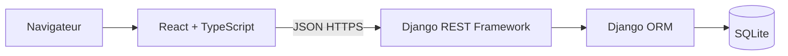
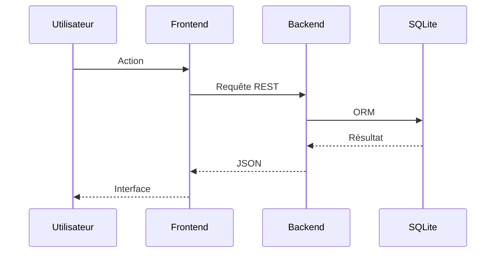

# Architecture SIGIS

## Vue globale

## Couches

- Présentation : routes, layouts, formulaires, appels HTTP.
- API : serializers, vues, permissions, validation.
- Métier : services et règles à créer dans les applications Django.
- Données : modèles Django ORM, migrations SQLite.

## Communication

Le frontend utilise `VITE_API_BASE_URL`, Axios et des réponses JSON standardisées. Les mocks MSW suivent le contrat central. CORS est limité aux origines configurées.

## Authentification

La fondation utilise actuellement la session Django côté configuration. Les endpoints d’authentification sont planifiés avant leur implémentation métier.

## Erreurs

Les erreurs utilisent `success: false`, un code stable, un message utilisateur et les erreurs par champ. Les erreurs réseau sont transformées en erreur standard côté Axios.

## Flux

