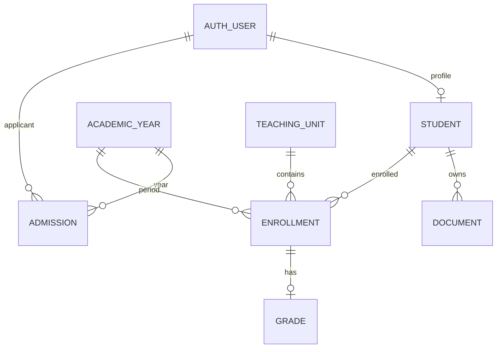

# Schéma de base

AcademicYear contient les périodes académiques. Student est lié à Django User. Admission référence le candidat et l’année. Document appartient à un étudiant. TeachingUnit décrit une UE. Enrollment relie étudiant, UE et année. Grade relie une inscription à sa note.

